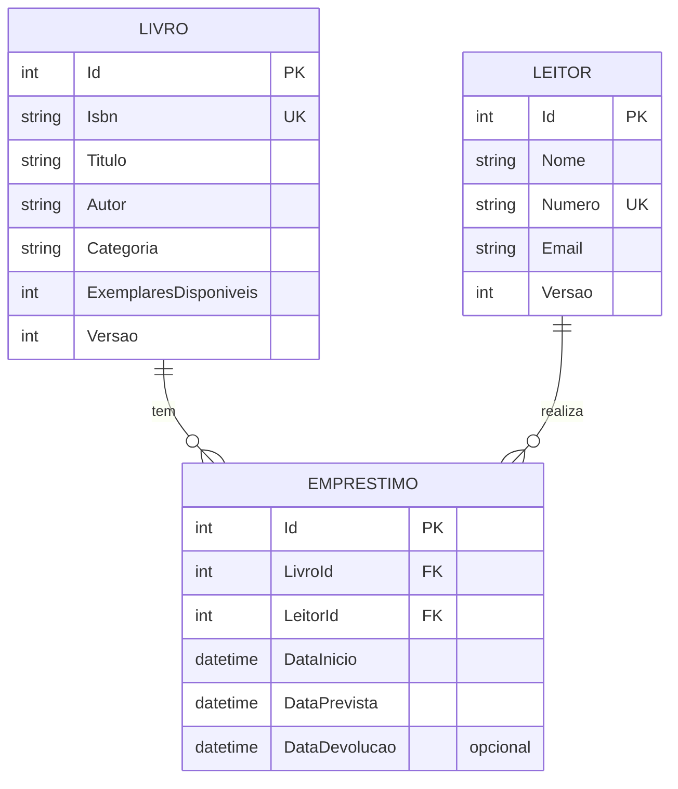

# Modelo de dados

`Id` é chave primária inteira gerada pela base de dados em cada entidade. Cada empréstimo está associado a um único livro e a um único leitor; um livro ou leitor pode ter zero ou muitos empréstimos. As chaves estrangeiras são obrigatórias.

## Restrições

| Elemento | Restrição |
|---|---|
| Livro.Isbn | Normalizado sem espaços/hífenes; ISBN-10/13 com controlo válido no servidor; índice único na BD |
| Livro.Titulo / Autor / Categoria | Obrigatórios; limites de 160 / 120 / 60 caracteres nos formulários |
| Livro.ExemplaresDisponiveis | Entre 0 e 10000; CHECK na BD e Range no formulário |
| Leitor.Nome / Numero / Email | Obrigatórios; 120 / 20 / 160 caracteres; email validado no servidor |
| Leitor.Numero | Espaços exteriores removidos; convertido para maiúsculas; índice único |
| Emprestimo.LivroId / LeitorId | FK com ON DELETE RESTRICT; preserva histórico |
| Emprestimo.DataPrevista | Igual ou posterior a DataInicio; CHECK na BD e validação no servidor |
| Emprestimo.DataDevolucao | Nula enquanto ativo; se preenchida, igual ou posterior ao início |
| Versao | Token de concorrência de livros/leitores; evita guardar formulários antigos |

SQLite não faz cumprir os tamanhos de `MaxLength` em colunas TEXT. Os limites de texto são aplicados nos ViewModels antes de guardar. As restrições numéricas, datas, índices únicos e chaves estrangeiras são efetivamente impostas pela BD. Os nomes dos índices e CHECK podem ser consultados em `database/esquema.sql`.

O índice `(DataDevolucao, DataPrevista)` apoia a consulta de atrasos. Não existe uma tabela de exemplares individuais: cada registo Livro representa um título/edição e mantém apenas a quantidade disponível. Não se acompanha cada exemplar físico nem o stock total. Uma devolução válida aumenta esse saldo em um; uma nova saída diminui-o em um.
